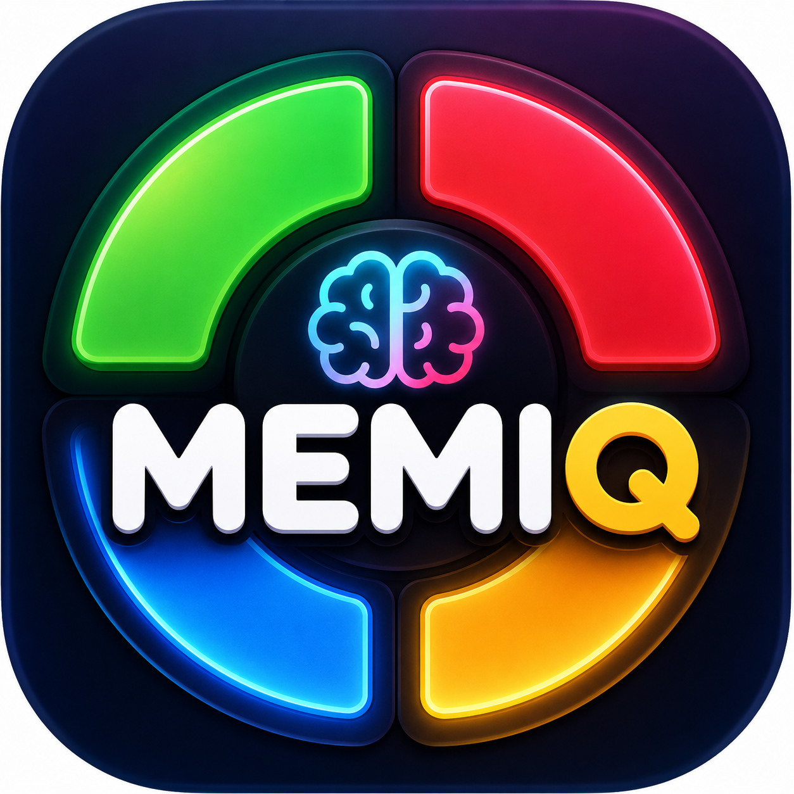

<div align="center">



# MEMIQ

**Memória, foco e reflexo em sequências que desafiam você a evoluir.**

Desenvolvido por **[AnchorLab Studio](https://anchorlabstudio.com.br)** (*AnchorLab Games*)

[](https://github.com/ePedroBorges/memiq/raw/main/build/memiq.apk)
[-3DDC84?style=for-the-badge&logo=android&logoColor=white)](https://github.com/ePedroBorges/memiq/raw/main/build/memiq.apk)
[](https://godotengine.org/)
[](./supabase/memiq_schema.sql)
[](https://anchorlabstudio.com.br/games/memiq)

**[Baixar para Android (APK)](https://github.com/ePedroBorges/memiq/raw/main/build/memiq.apk)** · **[Página Oficial do MEMIQ](https://anchorlabstudio.com.br/games/memiq)** · **[AnchorLab Studio](https://anchorlabstudio.com.br)**

<br />


</div>

---

## Sobre o Projeto

**MEMIQ** é um jogo da memória no estilo **Genius** com visual neon moderno, áudio sintetizado e progressão contínua. A mecânica é imediata — **observe o padrão de luzes e sons, memorize e repita na ordem correta** —, evoluindo em velocidade, número de passos, desafios sazonais, conquistas e duelos em rede local.

O projeto faz parte da frente **AnchorLab Games**, criada pela **[AnchorLab Studio](https://anchorlabstudio.com.br)** — empresa dedicada a **aumentar o lucro de seus clientes por meio de melhoria de processos (Lean Six Sigma), Inteligência Artificial e desenvolvimento de software sob medida**. No MEMIQ, essa mesma cultura de clareza, eficiência e acabamento de engenharia é aplicada a uma experiência casual de treino cognitivo e entretenimento multiplataforma.

---

## Download para Android (APK)

Você pode instalar o **MEMIQ** diretamente no seu celular ou tablet Android sem depender de loja de aplicativos:

| Opção | Link | Detalhes |
|---|---|---|
| **Download Direto (1 clique)** | **[Baixar `memiq.apk` (v1.4.0)](https://github.com/ePedroBorges/memiq/raw/main/build/memiq.apk)** | Baixa o instalador diretamente pelo GitHub |
| **Arquivo no Repositório** | [`build/memiq.apk`](./build/memiq.apk) | Localização do APK versionado no projeto |
| **Página Oficial** | **[anchorlabstudio.com.br/games/memiq](https://anchorlabstudio.com.br/games/memiq)** | Novidades, galeria e versões de outras plataformas |

**Ficha técnica do pacote Android:**
- **Versão:** `1.4.0`
- **Tamanho:** `32,2 MB` (`33.782.328 bytes`)
- **Arquitetura:** `ARM64 (arm64-v8a)`
- **Identificador:** `com.anchorlab.memiq`
- **Modo Offline:** funciona **100% offline** (internet é usada apenas se você optar por criar conta na nuvem ou consultar o Ranking Global)

### Como instalar no Android

1. No seu dispositivo Android, toque em **[Baixar `memiq.apk`](https://github.com/ePedroBorges/memiq/raw/main/build/memiq.apk)**.
2. Após concluir o download, abra o arquivo na barra de notificações ou na pasta **Downloads**.
3. Se o Android solicitar permissão, habilite **"Instalar apps desconhecidos"** para o seu navegador ou gerenciador de arquivos.
4. Toque em **Instalar**, abra o **MEMIQ** e comece a jogar.

---

## Para Quem É o MEMIQ (Personas)

| Persona | O que busca | Como o MEMIQ atende |
|---|---|---|
| **Jogadores Casuais** | Partidas rápidas entre tarefas ou no transporte, sem burocracia | Sessões de 2 a 5 minutos, funcionamento 100% offline, salvamento automático e layout confortável para celular em retrato ou paisagem |
| **Competidores e Amigos** | Desafio social, comparação de desempenho e metas claras | Duelos 1v1 na mesma rede Wi-Fi (LAN) com sequência idêntica para os dois jogadores, patentes (*Bronze* a *Lendário*) e Ranking Global |
| **Estudantes, Educadores e Treino Cognitivo** | Exercitar memória de trabalho, foco, atenção e velocidade de reação | Dificuldade progressiva em 40 fases sazonais e dois modos infinitos, tema Claro/Escuro e botão para rever o padrão |
| **Desenvolvedores e Avaliadores Técnicos** | Referência real de arquitetura em Godot e portfólio de produto | Código GDScript organizado, UI/tabuleiro/áudio 100% procedurais, rede ENet LAN e backend Supabase com Row Level Security (RLS) |

---

## Galeria

| Menu & Navegação | Tabuleiro em Ação | Progressão & Modos |
| :---: | :---: | :---: |
|  |  |  |

| Personalização & Coleção | Recursos & Interface |
| :---: | :---: |
|  |  |

---

## Funcionalidades

### Modos de Jogo
- **Infinito — Sequência:** modo clássico no estilo Genius; preserva o padrão anterior e acrescenta um novo sinal a cada rodada (com proteção contra 3 repetições seguidas da mesma cor).
- **Infinito — Aleatório:** gera uma sequência inédita a cada rodada, aumentando o número de passos e a velocidade conforme sua pontuação avança.
- **Fases Sazonais:** **40 fases por temporada bimestral** (`AAAA T1` a `T6`), divididas em 4 seções (*Treino*, *Aquecimento*, *Desafio* e *Maestria*), com metas de 4 a 20 sequências e recompensas especiais ao concluir as fases 10, 20, 30 e 40.
- **Multiplayer Local (Wi-Fi / LAN):** duelos 1v1 entre dois dispositivos conectados na mesma rede Wi-Fi usando endereço IP e `seed` compartilhada (ambos jogam exatamente a mesma sequência). O resultado atualiza seu histórico e sua patente competitiva (*Bronze*, *Prata*, *Ouro*, *Diamante* e *Lendário*, com proteção de perda de pontos em Bronze/Prata até duas derrotas seguidas).

### Progressão, Conquistas e Loja
- **XP e Níveis:** cada acerto concede XP, eleva seu nível e aumenta gradualmente o ritmo do jogo (`0,48s` até `0,22s` de exibição por sinal).
- **26 Conquistas Permanentes:** desafios de partidas, pontuação no modo Infinito, níveis, fases concluídas, recompensas e acúmulo de Ouro — rendendo **Ouro**, **Diamantes** e trilhas musicais exclusivas.
- **24 Recompensas por Nível:** **10 fundos neon animados**, **10 estilos visuais de tabuleiro 2×2** (*Clássico*, *Plasma*, *Solar*, *Crystal*, *Void*, *Midnight*, *Candy*, *Pop*, *Smooth*, *Master*) e **4 trilhas musicais**.
- **Loja In-Game (20 Itens):** **6 avatares**, **6 banners**, **6 estilos de nome** e **2 trilhas extras** desbloqueáveis com Ouro ganho nas partidas e Diamantes.

### Experiência, Visual e Áudio
- **Tema Escuro e Tema Claro:** alternância instantânea em `AJUSTES > APARÊNCIA`.
- **Áudio Procedimental:** **4 temas de efeitos sonoros** (*Clássico*, *Pop*, *Retrô* e *Bolha*) e **6 trilhas musicais** sintetizadas em tempo real, além de botão rápido de mudo dentro da partida.
- **Feedback Completo:** luzes de acerto/erro no tabuleiro, vibração háptica no Android e botão **Rever padrão (`↻`)** durante o turno.
- **Layout Responsivo:** suporte a **Retrato**, **Paisagem** e **Rotação Automática** (`AJUSTES > ORIENTAÇÃO`), respeito automático às áreas seguras (*notch*) e navegação pelo gesto/botão Voltar do Android.

### Conta e Nuvem (Opcional)
- **Offline-first:** recordes, níveis, conquistas, recompensas, perfil, fases e ajustes são salvos localmente no dispositivo (`user://memiq_scores.cfg`).
- **Sincronização na Nuvem:** criação de conta gratuita por e-mail e senha (com confirmação de e-mail e recuperação de senha) para salvar seu progresso, consultar o histórico de duelos e disputar o **Ranking Global**.

---

## Como Jogar

### Partida Solo ou Fases
1. No menu principal, toque em **JOGAR** e escolha **Infinito — Sequência**, **Infinito — Aleatório** ou **Fases**.
2. Observe as luzes e os sons reproduzidos no tabuleiro 2×2.
3. Toque ou clique nas quatro áreas exatamente na mesma ordem.
4. Durante a partida, use **`↻`** para rever o padrão atual ou **`III`** para silenciar o áudio, continuar, reiniciar ou voltar ao menu.

### Duelo Multiplayer em Rede Wi-Fi (LAN)
1. Conecte os dois aparelhos na **mesma rede Wi-Fi**.
2. **Anfitrião:** acesse `JOGAR > MULTIPLAYER > JOGAR EM REDE`, toque em **CRIAR SALA** e informe o **IP local** exibido na tela.
3. **Convidado:** no mesmo menu, toque em **ENTRAR**, digite o IP informado (porta padrão `28741`) e conecte-se. Quando os 2 jogadores estiverem na sala, o anfitrião toca em **INICIAR DUELO**.

---

<details>
<summary><strong>Documentação Técnica (Para Desenvolvedores)</strong></summary>

### Stack e Arquitetura
- **Motor:** Godot `4.6` (`GL Compatibility`), GDScript puro.
- **UI, Tabuleiro e Áudio:** construídos e sintetizados via código (`AudioStreamGenerator`, `StyleBoxFlat` e desenho customizado em `_draw()`), sem assets de áudio externos.
- **Multiplayer LAN:** `ENetMultiplayerPeer` na porta padrão `28741` com RPCs confiáveis e geração determinística da sequência por `seed`.
- **Backend (Supabase):** autenticação JWT (`/auth/v1`), API REST (`/rest/v1`) e banco PostgreSQL com Row Level Security (RLS) definido em [`supabase/memiq_schema.sql`](./supabase/memiq_schema.sql).

### Estrutura do Repositório

```text
memiq/
├── assets/                     # Ícone do app e splash screen institucional
├── build/
│   ├── memiq.apk               # Build Android pronta para instalação (v1.4.0)
│   └── memiq-release.aab       # Bundle Android (Google Play)
├── scenes/
│   └── main.tscn               # Cena principal
├── scripts/
│   ├── main.gd                 # Orquestração de telas, modos, HUD, conquistas, loja e áudio
│   ├── genius_board.gd         # Tabuleiro 2x2 customizado, paletas, animações e hit-test
│   ├── score_store.gd          # Persistência local (ConfigFile), XP, patentes e merge em nuvem
│   ├── supabase_client.gd      # Auth, refresh de sessão, sync, histórico e leaderboard
│   ├── multiplayer_manager.gd  # Lobby e duelo LAN via ENetMultiplayerPeer
│   ├── neon_background.gd      # Plano de fundo neon animado por tema
│   └── memiq_logo.gd           # Logotipo vetorial animado da tela inicial
├── supabase/
│   └── memiq_schema.sql        # Schema SQL e políticas RLS (profiles, progress, ranking, etc.)
├── tests/                      # Smoke tests (multiplayer LAN, scroll mobile e layout responsivo)
├── export_presets.cfg          # Presets de exportação (Android, Windows Desktop, Web, iOS)
└── project.godot               # Configuração do projeto Godot 4.6
```

### Abrir e Exportar pelo Godot 4.6

1. Abra esta pasta no **Godot 4.6**.
2. Instale os *Export Templates* do Android caso o editor solicite.
3. Vá em `Project > Export`, selecione o preset **MEMIQ** (`Android`) e clique em **Export Project**.

Via linha de comando (com `godot` no `PATH`):

```powershell
godot --headless --path . --export-debug Android build/memiq.apk
```

**Notas operacionais:**
- **E-mails em produção (Supabase):** configure um servidor SMTP próprio em `Authentication > Email` no painel do Supabase (o SMTP padrão possui limite de envio).
- **Firewall / Permissões:** no Windows, o firewall pode solicitar permissão na primeira vez em que uma sala LAN for hospedada; no Android, as permissões `INTERNET`, `ACCESS_NETWORK_STATE`, `ACCESS_WIFI_STATE` e `VIBRATE` já estão habilitadas em `export_presets.cfg`.

</details>

---

## AnchorLab Studio

A **[AnchorLab Studio](https://anchorlabstudio.com.br)** ajuda empresas a reduzirem custos operacionais e aumentarem sua margem de lucro por meio de **melhoria de processos (Lean Six Sigma)**, **Inteligência Artificial** e **software sob medida**.

- **Site oficial:** [anchorlabstudio.com.br](https://anchorlabstudio.com.br)
- **Página do MEMIQ:** [anchorlabstudio.com.br/games/memiq](https://anchorlabstudio.com.br/games/memiq)
- **LinkedIn:** [linkedin.com/company/anchorlab](https://www.linkedin.com/company/anchorlab/)
- **GitHub:** [github.com/ePedroBorges](https://github.com/ePedroBorges)
- **Contato:** [contato@anchorlabstudio.com.br](mailto:contato@anchorlabstudio.com.br)
